# AgentTape

<p align="center">
  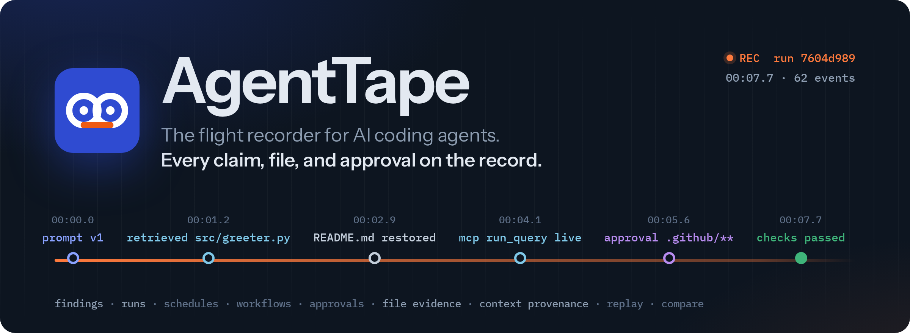
</p>

**Your coding agent reports that the tests already cover this case, and cites two lines
of a file. Did it read those lines? Do they say that? Do they still?**

AgentTape lets you trust but verify AI coding agents. Agents record findings that cite
exact lines of a file or a command's recorded output; AgentTape, not the AI, checks each
citation against its own recording of the run and shows you the cited lines beside a
verdict: the quote matches, the file changed after the read, the quote is not in what was
read, or no read of those lines was ever recorded.

**Checkable, not foolproof:** a matching quote shows the lines were in what the agent
read, not that its conclusion is right.

<picture>
  <source media="(prefers-color-scheme: dark)" srcset="docs/images/findings-dark.png">
  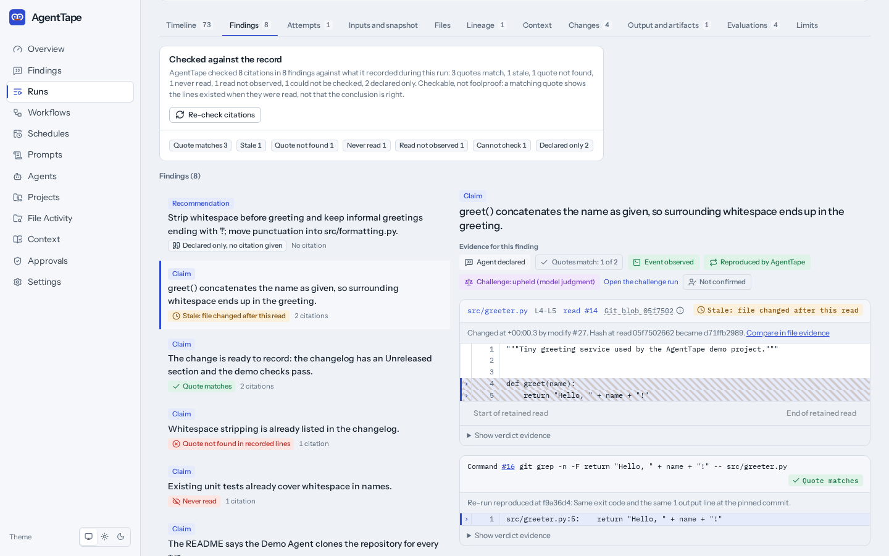
</picture>

One finding from the demo data, marked Stale: the file changed after the agent read it, so
the cited lines are hatched and both file hashes are shown. Below them, a cited command
that AgentTape re-ran with the same result.

**Start here:** the [Quick start](#quick-start), then [Try it](#try-it) on demo data. The
Demo Agent needs no credentials.

**Read next:** [Status](#status-early-with-one-maintainer) ·
[How verification works](#how-verification-works) ·
[Why you can trust the record](#why-you-can-trust-the-record) ·
[Where it fits](#where-it-fits) ·
[Known limitations](#known-limitations)

## The recorder underneath

A citation is only worth checking against a record AgentTape keeps itself, rather than
the agent's own summary, so the check sits on a run engine that keeps one. Every run
AgentTape starts, whether from the UI, the CLI, the API, a schedule, a webhook, or a
workflow, goes through the same engine and leaves an ordered, replayable record:
the prompt and settings it started from, every message, tool call, command, and output
line the agent reported, the files it reported reading, the files it changed, and the
checks it passed. Workflows, approvals, evaluations, replay, and comparison are built on
that same record. Verification is the point; the recorder and orchestration are the
foundation that makes it possible.

AgentTape runs the agents you already use rather than replacing them. Claude Code is the
one real agent whose findings it checks today; Codex CLI and any allowlisted command are
recorded (with less evidence) but cannot record findings. It is a local, single-user
tool at version 0.1.0, unreleased, under the MIT license.

## Status: early, with one maintainer

- **Version 0.1.0, unreleased.** Every [CHANGELOG](CHANGELOG.md) section (V1, M2, M3) is
  under "Unreleased". There is no package and no published image; you install from a
  source checkout and build the UI with Node and pnpm.
- **One maintainer, no independent review.** The code was built by a pipeline of AI
  agents (implementation agents, an AI adversarial reviewer, fixes, a readiness review)
  directed by that maintainer. The threat model and tests came out of the same process.
  There has been no independent review or audit.
- **Built for one technical person on one machine.** No accounts or roles, so an approval
  or confirmation is attributed only to a self-reported actor name
  ([Trust boundary](#trust-boundary)). A team and remote workers are extension points,
  not features. SQLite is the default and the database `make check` runs against; Docker
  and PostgreSQL were checked by hand ([Platform](#platform)).
- **MIT licensed.** See [License](#license).
- **What is built.** V1 (run engine, recorder, scheduling, workflows, approvals,
  evaluations, replay), M2 (the optional [Herdr](#where-it-fits) terminal runtime, file
  evidence, context provenance), and M3 (verified findings). Open items are in
  [Known limitations and open items](docs/FOLLOW-UPS.md).

## When an agent changes your code, the evidence scatters

Coding agents such as Claude Code and Codex now run for minutes at a time, on
schedules, from CI, and inside multi-step pipelines. When one of them changes your code,
the evidence is scattered: terminal scrollback that is gone, a diff with no context, an
agent's own summary of what it thinks it did. The questions at the top of this page are
hard to answer, and so are these:

- Which prompt, model settings, repository state, and inputs produced this change?
- What commands did the agent run, what did they print, and which files did it touch?
- Did the result pass the checks it was supposed to pass, and did anyone approve the
  risky part?
- Can I run exactly the same thing again, or change one variable and compare?

Without answers, you either babysit agents or trust their narrative. AgentTape replaces
the narrative with a record, and checks the agent's citations against it:

| Typical setup | AgentTape |
|---|---|
| An agent says it read a file and found X | Its findings cite lines and recorded events; AgentTape checks each citation against what it recorded and shows the ones that fail instead of hiding them ([how](#how-verification-works)) |
| Each entry point (terminal, cron, CI, a script) runs the agent its own way | One run engine: the UI, CLI, API, schedules, webhooks, and workflows all create the same run record, starting from a snapshot of prompt, settings, commit, and environment |
| Logs are free text in whatever format the tool prints | A vendor-neutral, ordered event stream (messages, tool calls, commands, output, file writes, Git changes, artifacts, usage, evaluations, approvals) |
| "It said the tests passed" | Evaluators check the recorded data and the run's working directory, and a failed required check fails the run; approval nodes and commits wait for a person ([Check](#check-evaluations-replay-fork-compare), [Orchestrate](#orchestrate-workflows-and-approvals)) |
| "Run it again and see" | Replay reuses the snapshot, fork changes one thing, and Compare shows both side by side |

## How verification works

### One citation, followed through

In the seeded "Refactor with Full File Evidence" run, the agent records the finding
*"Existing unit tests already cover whitespace in names."* and cites lines 4 to 5 of
`tests/test_greeter.py`. AgentTape shows that citation as **Never read**: the run's
evidence window is complete, and no read of that file was ever reported. The claim may be
true or false; what AgentTape shows is that nothing the run reported reading backs it.

### How a finding gets recorded

A finding is recorded only when the agent calls the `record_finding` tool of the
AgentTape MCP server, citing a file line range with a quote copied exactly, or the output
of a recorded tool call. The agent has to cooperate, and nothing forces it to:

- **In a Claude Code run AgentTape launches**, each attempt gets its own AgentTape MCP
  server with the tool pre-approved, and a findings contract (cite only what you read,
  copy quotes exactly, one call per finding) is appended to the system prompt. That is an
  instruction to the model, not a guarantee; a run with no findings has nothing to check.
- **In your own interactive Claude Code session**, a one-time `agenttape mcp register`
  makes the tool available and `agenttape hooks setup` records the session's tool calls
  and reads (both change your Claude Code configuration; see
  [What it keeps and changes](#what-it-keeps-and-changes-on-your-machine)). The session
  does not get the contract: paste it into your request or your project's `CLAUDE.md`
  ([Claude Code integration](docs/integrations/claude-code.md#interactive-sessions-and-claude-code-in-herdr)).
- **Codex CLI and Generic Command runs cannot record findings**; their Findings tab says so.

### What AgentTape checks

When the run finishes (and again on request), a deterministic checker compares each
quote with what the run recorded reading (or, for an event citation, the cited call's
recorded output), after one documented normalization (line endings, Unicode NFKC,
trailing whitespace). Nothing is fuzzy or semantic, no model is involved, and the live
file is never consulted. Each citation gets one verdict: **Quote matches**, **Stale**
(the file changed after this read), **Quote not found**, **Never read**, **Read not
observed** (AgentTape could not have seen every read, so it says nothing either way), or
**Cannot check** (with one of eight named reasons). A finding with no citation is
**Declared only**. Failed citations are shown and flagged, never hidden; a re-check
appends a verdict, and a re-run or a challenge never overwrites one.
[FINDINGS](docs/FINDINGS.md) states what each verdict shows and what it does not.

Above the verdicts, each finding shows an evidence ladder: the agent declared it, its
quotes match, a cited event was observed, AgentTape re-ran a cited command and got the
same answer, a second agent challenged it (labelled model judgment, never proof), and a
person confirmed it. The ladder is never summed into a score.

### Where the evidence comes from

What a matching quote shows depends on who reported the read. AgentTape distinguishes
three kinds of run:

| Kind of run | Who starts the agent | Reads and findings come from | File changes come from | A matching quote shows |
|---|---|---|---|---|
| **Launched run** | AgentTape, as a child process | Reads: the output stream of the process AgentTape started. Findings (Claude Code): an MCP server AgentTape starts for that attempt | The agent's stream, plus AgentTape's file watcher and Git reconciliation | the lines were in what the process AgentTape started returned for that read |
| **Observed session** | You, in your own terminal | Claude Code hooks and the registered MCP tool, sent by the session itself | The session's own hooks only; no watcher or Git reconciliation runs for it | the lines are consistent with what the session reported |
| **Herdr-hosted run** | AgentTape, in a [Herdr](#where-it-fits) pane | For Claude Code, the same hooks and MCP tool as an observed session; Codex in a pane reports no reads and records no findings | AgentTape's watcher and Git reconciliation on the pane's directory | the lines are consistent with what the session reported |

In every case, a read is known only because the agent's own tooling reported it:
AgentTape does not watch reads at the filesystem. The citation header says which a
verdict was checked against: "Git blob" (the exact lines exist as an object in the run's
repository) or "Reported output". In the Findings inbox, a Herdr-hosted run's findings
show as a launched run's.

### On a real run

From the [CHANGELOG](CHANGELOG.md): M3 was accepted on a real Claude Code analysis of this
repository, both launched by AgentTape and in an observed session, that caught a bad
citation. The caught citation quoted lines the agent had seen only in a Grep result and
cited them as a file it read, which AgentTape showed as "Never read"; the quote itself was
accurate. The same acceptance found one wrong verdict from AgentTape (a redaction defect,
since fixed) and reads cut at the event cap (also fixed). That is one analysis of one
repository, not a benchmark.

## Why you can trust the record

How the record behind every verdict is kept; where each guarantee stops is in
[Known limitations](#known-limitations).

- **No model in the loop.** AgentTape itself calls no language model and depends on no
  model SDK: verdicts, evaluations, approvals, and budgets are decided by code or by a
  person. Models run only inside the agents it launches or observes, and their output is
  recorded as data, never read as an instruction to AgentTape. The one feature that asks a
  model about a finding is **Challenge findings**, which you start (or a workflow's
  `finding_review` node): it runs a second agent on a reviewer profile you choose, with
  its own usage and cost, as an ordinary recorded run, and its answer is labelled model
  judgment and never changes a verdict.
- **Ordered, with truncation marked.** Events get gap-free per-run sequence numbers
  inside the same transaction that writes them. Full redacted output goes to raw log
  files (up to 50 MB per stream) even when the timeline keeps only the first 2 MB per
  stream, and anything cut is marked as cut.
- **Replayable inputs.** The snapshot (prompt text and variables, profile config, project
  settings, starting commit, environment) is written once, at creation, and AgentTape
  never rewrites it. Replay reuses it and flags drift in HEAD or environment; the agent's
  output on a replay can still differ, because the model is not deterministic.
- **Honest numbers.** Token usage and cost appear only when an adapter reports them. The
  Demo Agent's numbers are labelled simulated and never counted as real. Unknown values
  show as "Not reported", never zero.
- **Race-safe state.** Runs, attempts, and workflow steps follow explicit state machines;
  transitions are conditional updates, so a cancel racing a finish cannot overwrite it.
  Two workers can never claim the same run (tested with racing threads, and with
  separate database engines racing on one database).
- **Secrets are redacted before storage.** Prompts reference secrets by name; values are
  resolved only when an agent starts, and every persistence path redacts the values the
  attempt resolved plus common credential patterns. Hook events and findings from your
  own Claude Code sessions (and a few other cases in
  [SECURITY.md](docs/SECURITY.md) T16) get patterns and `AGENTTAPE_REDACT_ENV` values
  only, so a bare secret that matches no pattern can be stored there.
- **Safe by default, within a stated boundary.** Loopback only unless an API token is
  configured (stored only as a hash); commands run as argument arrays, never through a
  shell; launched agents work in allowlisted directories or AgentTape-owned Git worktrees;
  AgentTape's own Git calls never push, merge, or reset. The command policy covers what
  AgentTape launches, not what an agent does inside its own session
  ([Trust boundary](#trust-boundary)). Details and the threat model:
  [docs/SECURITY.md](docs/SECURITY.md).

## Quick start

Needs `make`, Python 3.12+, [uv](https://docs.astral.sh/uv/), Node 22.22+ with pnpm (to
build the UI from source; there is no prebuilt package), and git. Linux, macOS, or WSL2.

```bash
git clone https://github.com/jameskbb/agent-tape.git
cd agent-tape
make setup      # install dependencies, create ~/.agenttape and its database
make build      # build the web UI into the Python package
make seed       # optional: demo data
cd backend && uv run agenttape serve
```

Then open <http://127.0.0.1:8787>. If you seeded, follow [Try it](#try-it). `make seed`
takes 10 to 30 seconds because it executes the demo runs for real, and `make reset-demo`
removes only demo data. Binding to anything but loopback requires an API token:
`agenttape token create`.

On Windows, set up the repo inside WSL, then start it with
`scripts\windows\AgentTape.cmd` ([details](docs/DEPLOYMENT.md#windows-through-wsl)).
To run it in a container instead, see [Container](docs/DEPLOYMENT.md#container): the
`docker compose` setup requires a token and has no agent CLIs in the image.

To check findings from Claude Code, see the
[Claude Code integration](docs/integrations/claude-code.md): launched runs need only a
Claude Code profile; your own sessions need the one-time setup
[described above](#how-a-finding-gets-recorded).

## Try it

### In the browser

After `make seed` and `serve`, with the app open:

1. **Overview** shows the seeded history: runs that succeeded, one that recovered on a
   retry, one that failed its checks, one that timed out, and the "Safe Code Change"
   workflow waiting for you. (A "New here?" banner offers a one-minute guided setup.)
2. Open **Findings** in the sidebar, or the "Refactor with Full File Evidence" run's
   Findings tab: the seeded findings show at least one citation for every verdict (the
   Read not observed citation is a labelled seeded stand-in). Click a finding for
   its cited lines and evidence ladder, and open its challenge run, "Challenge: Refactor
   with Full File Evidence".
3. Open **Runs** and pick "Validate greeting names": the timeline, the commands it ran,
   the real diff it made in its own copy of the demo repository, its artifacts, and the
   exit-code evaluation. Its token usage is labelled simulated.
4. Open the waiting workflow from **Waiting for you**, approve it, and watch the
   remaining nodes run.
5. Open "Improve the greeting service (baseline)" and use **Compare** against its fork.
6. Open "Refactor with Full File Evidence" for the **Files** and **Context** tabs shown
   in [the tour](#a-tour) (the demo approves the Demo Agent's declared protected-path
   write for you).
7. **Schedules** has a nightly run, paused. Press **Run now** to create a run from it.
8. Press **Start a demo run** on the Overview or Runs page to record a new run live.

### From the command line

Profiles, prompt templates, and projects resolve by name or id. `-i` values are parsed
as JSON when they can be (`true`, `5`), otherwise kept as text. If no worker is running,
`run --follow` executes the run in the CLI process (`--inline/--no-inline` overrides).

```bash
cd backend
uv run agenttape run -p "Demo Agent" -t "Improve the greeting service" \
  --project "AgentTape Demo Project" -i goal="Reject names that are only whitespace" \
  -i add_tests=true --title "Whitespace names" --follow
uv run agenttape runs list --status succeeded --limit 5
uv run agenttape runs fork <run-id> -i goal="Also trim surrounding whitespace" --follow
uv run agenttape runs compare <run-id> <fork-id>     # config, usage, and Git side by side
uv run agenttape runs challenge <run-id> --profile "<reviewer profile>"   # model judgment
uv run agenttape export <run-id> --zip -o run.zip     # sanitized bundle
uv run agenttape doctor                               # adapters, workers, scheduler, config
```

Other commands cover runs (`runs show|cancel|retry|replay|challenges`), capture for your
own Claude Code sessions (`hooks`, `mcp`), `prompts`, `schedules`, `agents`, `projects`,
`executables`, `git`, `triggers`, `secrets`, `retention`, `token`, and `demo`, plus
`worker` and `scheduler` to run those processes separately. `agenttape --help` lists
them all.

### From CI or a script

Create a trigger under **Settings → Webhook triggers** (its token is shown once), then
post to it. The trigger's own token authenticates the call, and the same
`Idempotency-Key` (or GitHub's `X-GitHub-Delivery`) never starts a second run:

```bash
curl -X POST http://127.0.0.1:8787/api/v1/webhooks/<trigger-id> \
  -H "Authorization: Bearer $AGENTTAPE_WEBHOOK_TOKEN" \
  -H 'Content-Type: application/json' -H 'Idempotency-Key: ci-run-8123' \
  -d '{"client_payload": {"goal": "Reject names that are only whitespace"}}'
# 202 {"status": "accepted", "run_id": "...", ...}; a repeat returns 200 with "duplicate": true
```

The REST API behind the UI accepts the same `Idempotency-Key` when starting runs and
workflow runs, and streams a run's events as Server-Sent Events, resumable with
`Last-Event-ID` ([API](docs/API.md), [TRIGGERS](docs/TRIGGERS.md)).

## Where it fits

AgentTape sits beside the tools you already use and replaces none of them.

| Tool | What AgentTape does with it |
|---|---|
| **Claude Code** | Launches `claude -p` as a subprocess and records its stream, or observes the sessions you start yourself through hooks and an MCP tool. The only real agent whose findings are checked. |
| **Codex CLI** | Launches `codex exec` and records its events, commands, and file changes. Codex reports no file reads and no cost, and cannot record findings. |
| **Any other CLI** | An allowlisted executable run as an argument array; JSONL on its output becomes structured events. |
| **[Herdr](https://herdr.dev)** (optional) | A terminal host for agents. AgentTape can start Claude Code or Codex in a Herdr pane, follow its state, and reattach after a restart. Nothing requires it ([HERDR](docs/HERDR.md)). |
| **Git** | Each run can get its own worktree on an `agenttape/run-<id>` branch in your repository; AgentTape records the starting commit and the diff, and makes a local commit only after a person approves it. AgentTape's own Git calls never push, merge, or reset; the agent itself can still run Git inside its session if its permission mode allows. |
| **CI and scripts** | Webhook triggers start runs, with idempotency keys so a retried delivery never starts a second run. Nothing goes back out: no pull request comment, status check, or chat message; exports are manual. |

### What it keeps and changes on your machine

- **Everything it records** lives in the data directory (`~/.agenttape`, owner-only):
  the SQLite database, artifacts, full redacted raw logs, AgentTape-owned worktrees, and,
  so citations can be checked later, redacted copies of file content the agent read
  (capped at 1 MiB per read). Nothing is deleted automatically: retention cleanup runs
  when you apply it, after a dry-run preview ([DEPLOYMENT](docs/DEPLOYMENT.md#data-backups-and-retention)).
- **In your repositories**, each run's worktree lives in the data directory and its
  approved commits land on its `agenttape/run-<id>` branch. AgentTape deletes only
  branches it created, and removes a worktree only when no uncommitted work would be lost.
- **Capturing your own sessions changes your Claude Code configuration.**
  `agenttape hooks setup` writes five hooks, with a token, into your user-level Claude
  Code `settings.json` (and makes it owner-only), and `agenttape mcp register` registers
  a user-scope MCP server, so both apply to every Claude Code session on the machine.
  Only sessions inside a registered project become runs. Each hook times out after 3
  seconds and fails open, so a stopped AgentTape never blocks Claude Code; it just
  records nothing. `hooks remove` and `mcp unregister` undo both.

### What it is not

Not a sandbox (agents run with your permissions), not a judge of whether a finding is
true, not a model gateway (it calls no model itself), not a tamper-proof ledger (see
[Trust boundary](#trust-boundary)), not a team service (one user, no accounts),
and not a pull request bot (AgentTape posts nothing to pull requests, chat, or tickets).

## A tour

The tour shows demo data, which `make seed` creates. It follows the same order as the
product: verify, record, orchestrate, check, automate.

### Verify: findings you can check

The Findings tab at the top of this page is where a run's findings land: each citation's
verdict next to the cited lines AgentTape retained, and the finding's evidence ladder.
**Challenge findings** asks a second agent to read the same evidence as its own recorded
run. A person can **Confirm** a finding instead, which appends an audit log entry.

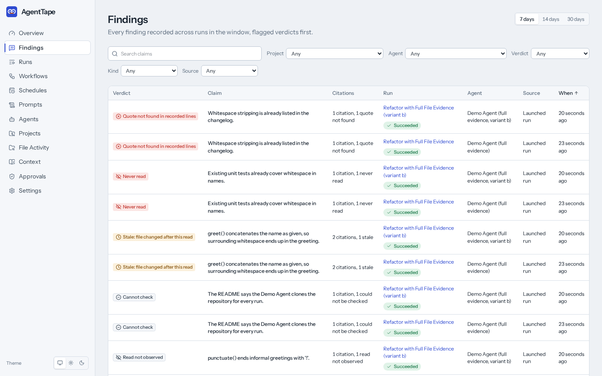

The sidebar's **Findings** inbox lists findings across every run in a window, flagged
verdicts first, including interactive Claude Code sessions, whether recorded through hooks
or through the MCP server alone.

<picture>
  <source media="(prefers-color-scheme: dark)" srcset="docs/images/overview-dark.png">
  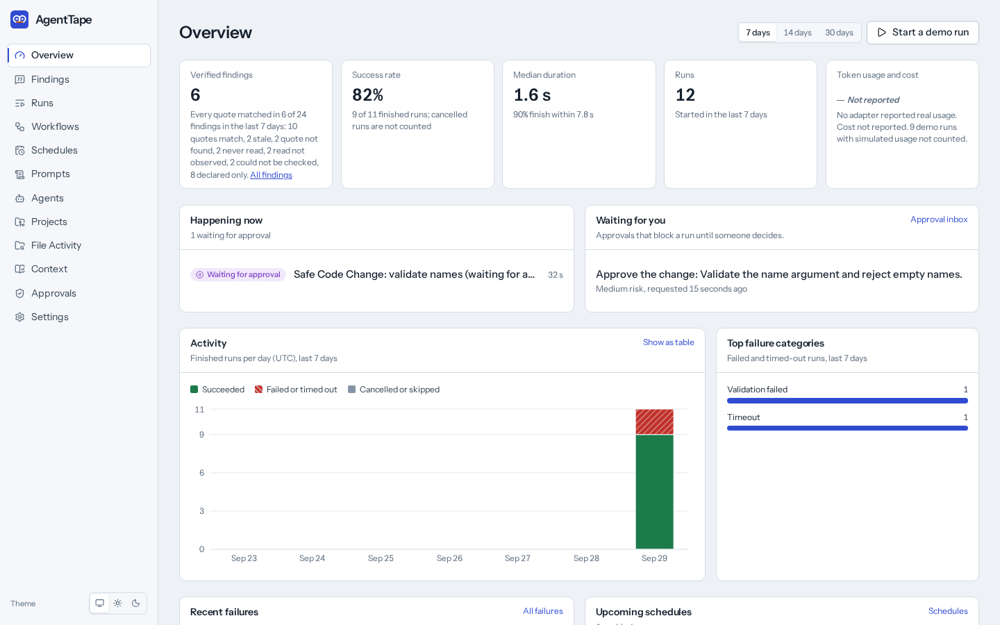
</picture>

The Overview's first tile, "Verified findings", counts the findings in the window whose
every quote matched, next to a breakdown by verdict, and links to the inbox. It is the
only place the product calls a finding verified, and it means exactly that.

### Record: what the agent actually did

A check is only as good as the record it checks against. *"Why did last night's run
touch `CHANGELOG.md`?"* Open the run. Its snapshot shows the exact prompt version and
rendered text, the agent profile version, the project settings, and the commit it
started from. The timeline is a filterable, searchable, live stream of every message,
tool call, command, and output line, each stamped with its elapsed time; expand one to
see a command's exact argument array or the raw event JSON. Other tabs hold the run's
findings, attempts (with raw logs), files, lineage, context, changes, output and
artifacts, evaluations, and limits.

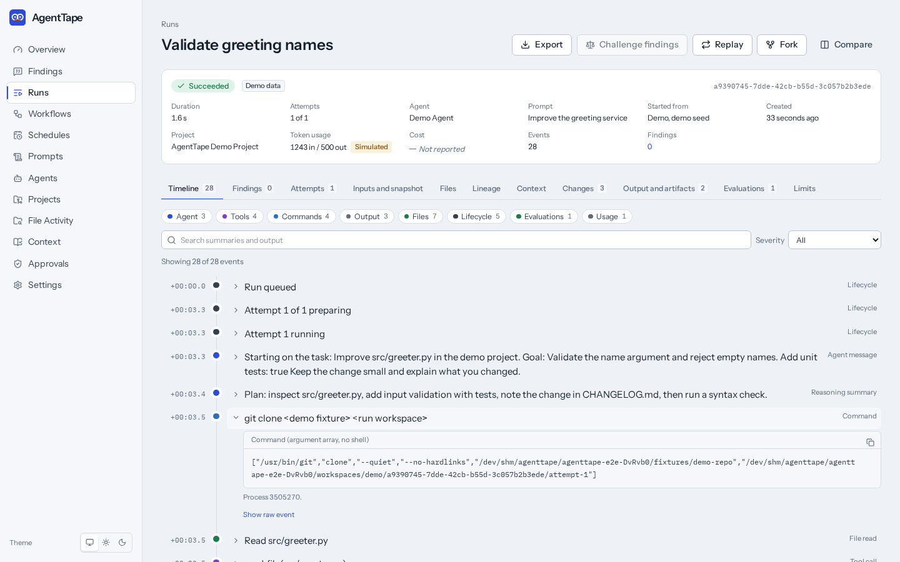

| 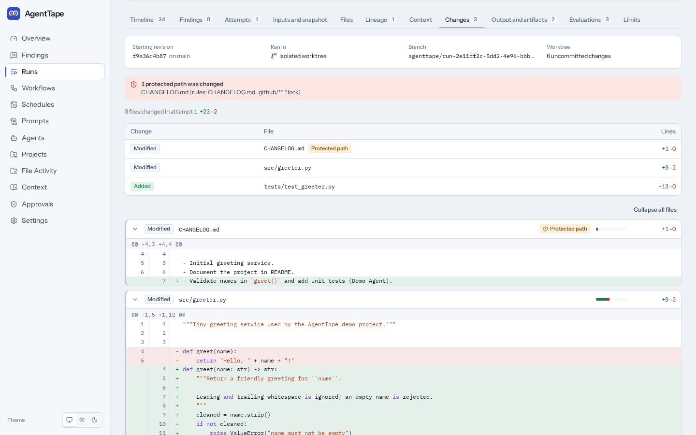 | 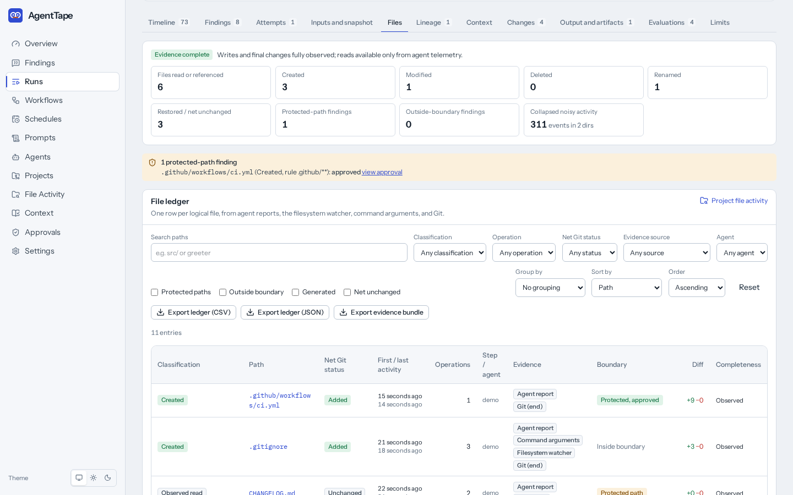 |
|---|---|
| **Changes**: the diff from the run's own worktree, with `CHANGELOG.md` flagged as a protected path and the validation commands that ran | **Files**: every file the run read, created, modified, renamed, restored, or deleted, and how each was observed. (The approved protected-path write is the Demo Agent's: it asked first.) |
| 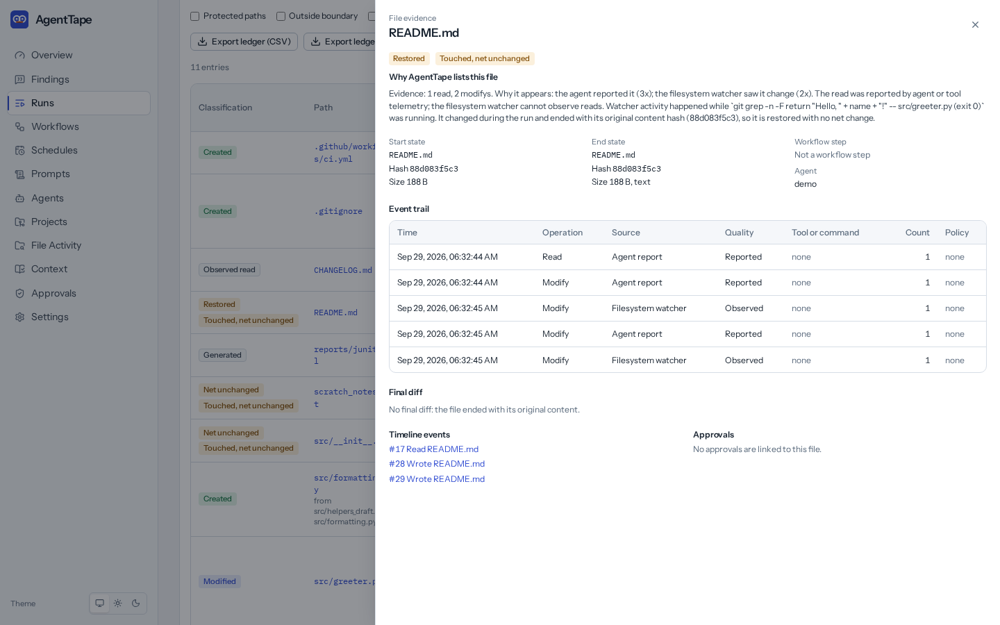 | 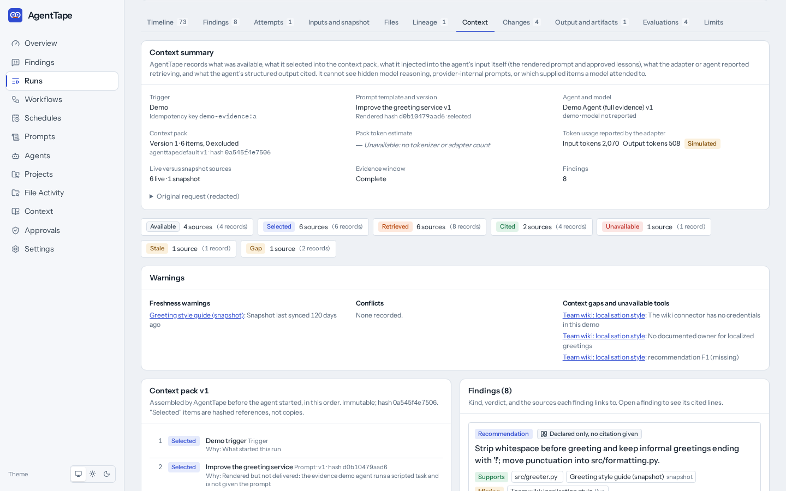 |
| **One file's evidence**: `README.md` was edited and put back, so it is *touched, net unchanged* | **Context**: what was available, selected, retrieved, injected, and cited, what was stale or missing, and a findings summary that opens each finding on the Findings tab |

The Files tab combines agent telemetry, a live filesystem watcher, and Git
reconciliation; noisy directories such as `node_modules/` collapse into counts, and reads
are claimed only when an agent reports them ([FILE-EVIDENCE](docs/FILE-EVIDENCE.md)).
The Context tab records each run's immutable context pack; corrections stay tied to their
run until a person approves them as a durable lesson ([CONTEXT-EVIDENCE](docs/CONTEXT-EVIDENCE.md)).
**File Activity** and **Context** in the sidebar roll the same evidence up per project:
most-touched files, files in failed runs, files that change together, sources that are
never selected or often stale.

### Orchestrate: workflows and approvals

A workflow is a DAG of `agent_run`, `command`, `transform`, `evaluation_gate`,
`finding_review`, `approval`, `condition`, and `collect` nodes; later nodes read earlier
outputs through templates such as `{{ nodes.implement.outputs.files_changed }}`, and
independent branches run in parallel. Build one in the editor (or
`POST /api/v1/workflows` as JSON); saving creates a new version, and runs keep the version
they started with.

| 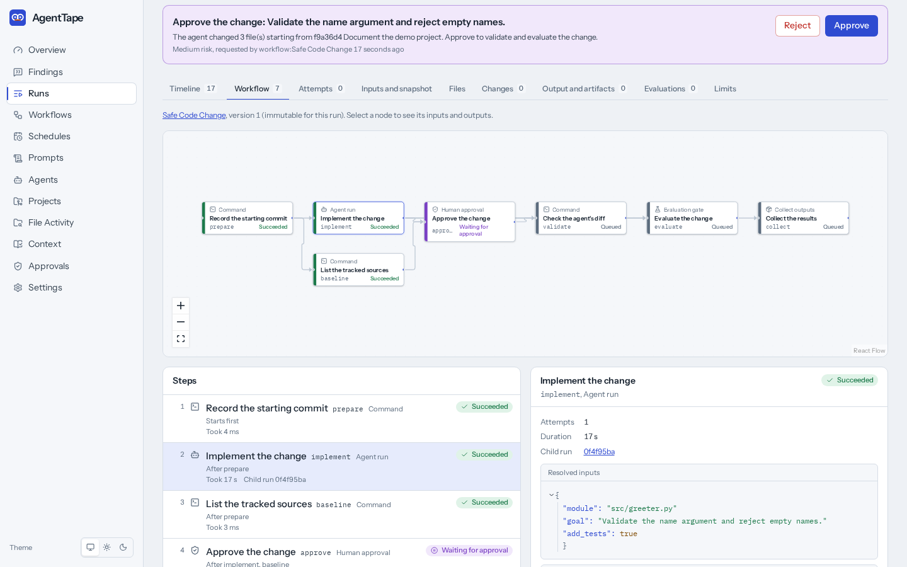 | 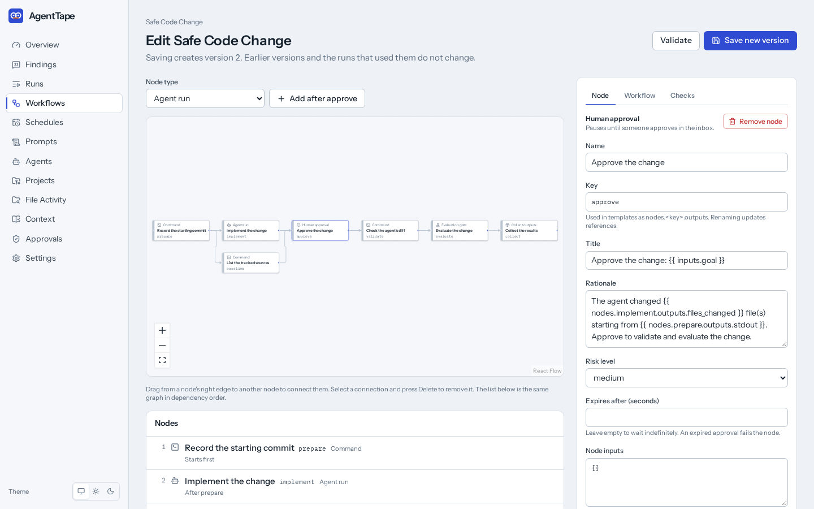 |
|---|---|
| A workflow run paused for approval; finished steps are not re-run after it resumes | The editor: graph, node list, and a form per node type |

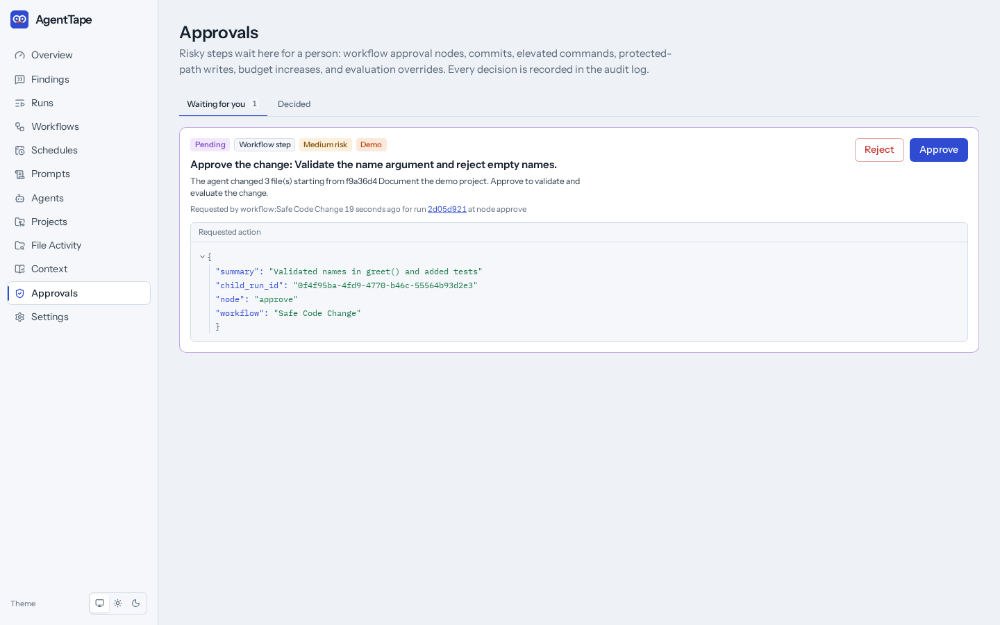

**Approvals** collects what waits for a person: workflow approval nodes, commits,
elevated commands, budget increases, evaluation overrides, and protected-path writes an
agent declares before making them (only the Demo Agent does). A real agent's
protected-path write is detected after it happens and flagged for review, not held for
approval ([FILE-EVIDENCE](docs/FILE-EVIDENCE.md#protected-paths-and-the-boundary)).
Approvals are durable: a paused run survives a restart and resumes where it stopped. The
**Decided** tab keeps the history, and each decision is written to the audit log
(read through the API only; the actor name is self-reported). Details:
[ORCHESTRATION](docs/ORCHESTRATION.md).

### Check: evaluations, replay, fork, compare

Evaluators return pass, fail, warning, error, or skipped with their evidence. Those that
read only the recorded data are deterministic: `exit_code`, `git_diff`, `regex`,
`json_schema`, `artifact_produced`, `duration`, and `usage_cost`. `command`,
`file_exists`, and `file_absent` check the run's working directory, and `human_score`
records a person's score on the run's Evaluations tab. Group them into suites under
**Workflows → Evaluations**; a failed required check fails the run. (An agent-as-judge
evaluator has an interface but no backend in V1, and reports itself as unavailable.)
Replay a run with its exact snapshot, fork it with one thing changed, and compare the two.

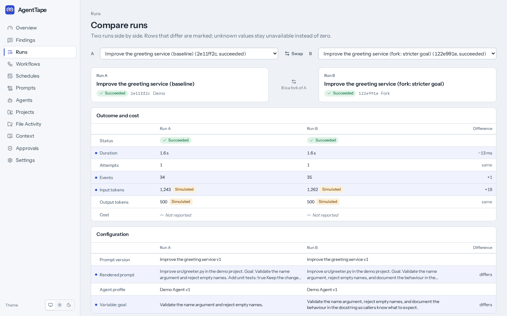

### Automate: prompts, schedules, and webhooks

| 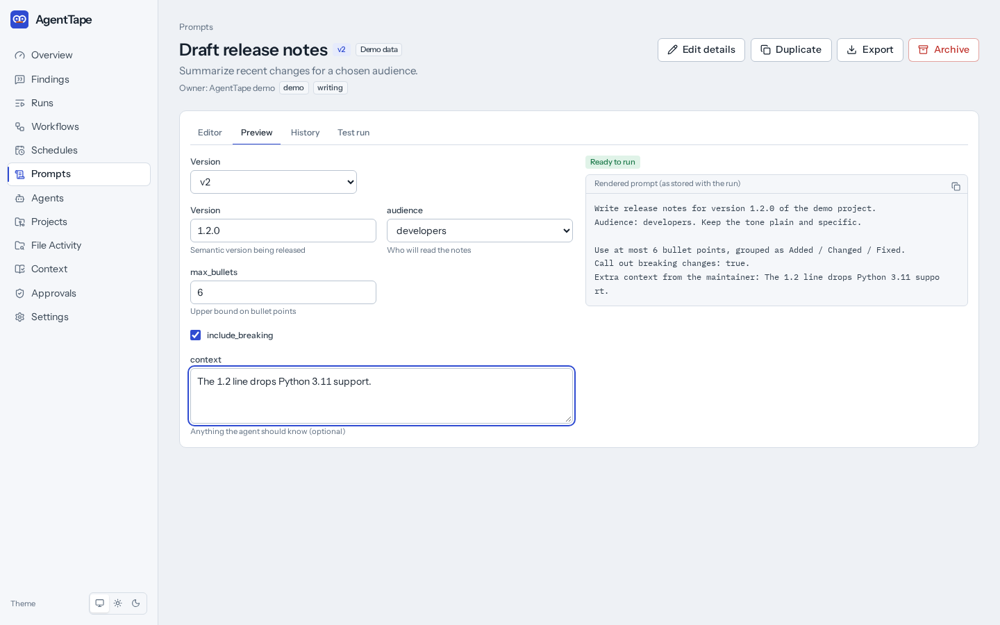 | 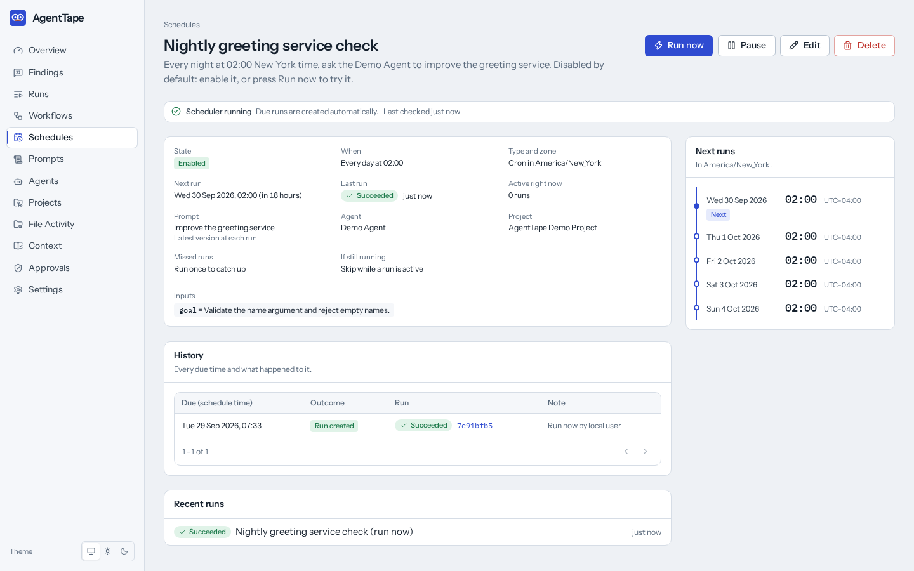 |
|---|---|
| **Prompts** are versioned templates with typed variables (string, multiline, number, boolean, enum, path, secret reference); preview, test-run, diff versions, import and export | **Schedules**: one-time, interval, or cron in any time zone, with DST-correct next runs, a missed-run policy, and queue, skip, or cancel-and-replace on overlap |
| 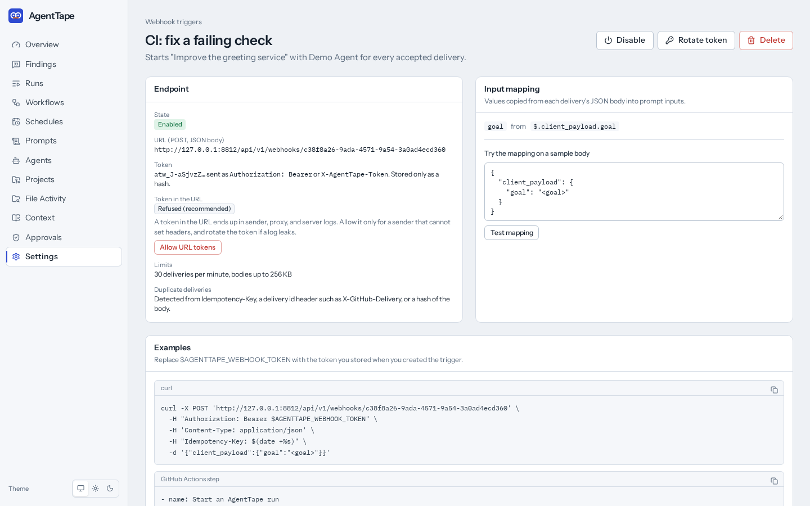 | 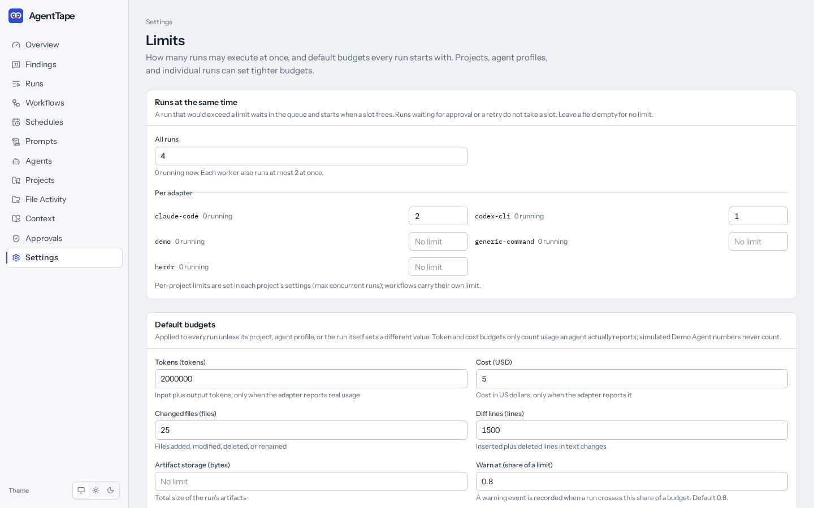 |
| **Webhook triggers** (Settings → Webhook triggers) map JSON payload fields to prompt inputs; the page generates curl, GitHub Actions, and `gh api` snippets | **Limits** (Settings → Limits): a global run cap, a cap per adapter, and default budgets for tokens, cost, changed files, diff lines, and artifact storage; projects and workflows set their own caps |

### Configure: agents, projects, runtimes

- **Agents**: versioned profiles for the Demo Agent, a generic command, Claude Code,
  Codex CLI, and the optional Herdr runtime (**Settings → Runtime** shows its status and
  tests the connection; [HERDR](docs/HERDR.md)). The **Adapters** tab discovers installed
  CLIs without touching their credentials, and the **Secret references** and **Executable
  allowlist** tabs hold the names agents may use.
- **Projects**: allowlisted repository roots, Git isolation (a worktree per run),
  protected paths, validation commands, environment allowlists, artifact rules, timeouts,
  and a concurrency cap.
- **Data**: retention rules under **Settings → Data retention** (or `agenttape
  retention`), and export of any run as sanitized JSON or a zip bundle, including its
  findings and their verdicts.

The dark theme follows your system setting or a manual toggle:

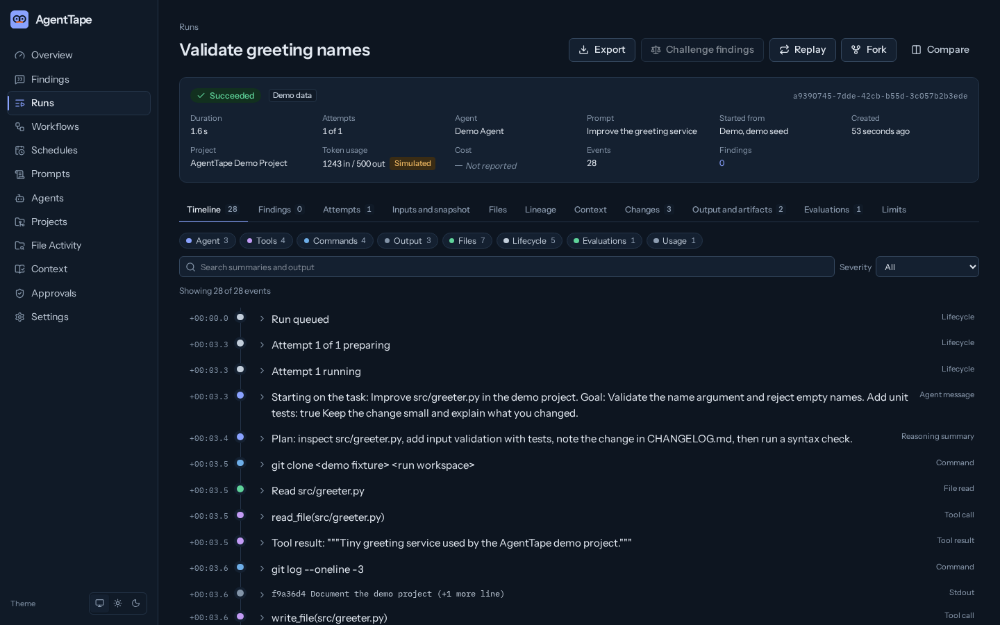

## How it works

```
 UI / CLI / API / schedule / webhook / workflow
                    |
                    v
        RunService.create_run: validates inputs, renders the prompt with secret markers,
                    |          snapshots config + Git state, records "queued", enqueues
                    v
         database queue (leases) --> worker --> executor (agent | workflow)
                                                   |
                          adapter (demo, generic, Claude Code, Codex, Herdr runtime)
                                                   |  argument arrays in their own process
                                                   |  group (or a Herdr pane)
                                                   v
             events (redacted, sequenced) + raw logs + artifacts + file changes
                                                   |
      file evidence (telemetry + watcher + Git) and context evidence (packs, provenance)
                                                   |
              citation checks, re-runs, evaluators, approvals, budgets, Git isolation
                                                   |
                          browser (live Server-Sent Events), exports
```

AgentTape is a modular monolith in Python (FastAPI, SQLAlchemy, Alembic, Typer) with a
React web UI. `agenttape serve` runs the API, UI, worker, and scheduler in one process;
workers and the scheduler can also run separately. SQLite is the default database.
Architecture: [docs/ARCHITECTURE.md](docs/ARCHITECTURE.md) and the
[decision records](docs/adr/).

## Correctness and testing

`make check` runs every quality gate and prints a summary: Python format, lint, and
strict type checks; the Python test suite (2135 tests on SQLite, all passing, unit and
integration, each on its own temporary database); a migration upgrade, downgrade, and
drift test; frontend lint, format, type checks, vitest unit tests, and production build;
a secret scan; static container checks; a Docker build when Docker is installed; and
Playwright end-to-end tests of the main user journeys, plus automated accessibility
(WCAG 2.1 AA) scans in both themes, a tablet-width check, and keyboard navigation. A
gate that cannot run in the environment is reported as `SKIPPED-EXTERNAL`, never as passed. No test calls a language model.

Examples of what the tests prove, beyond the claims above: a timeout or cancel kills
the agent's whole process tree; interrupted attempts are reconciled after a crash;
schedules never create duplicate occurrences across restarts and DST changes; planted
secrets never appear in events, logs, or exports.

## Known limitations

### What verification cannot tell you

- **Checkable, not foolproof**: AgentTape checks that cited lines were in what the run
  read, not that they support the conclusion. Challenge findings is model judgment,
  never proof.
- **Findings depend on the agent**: among real agents only Claude Code records findings
  (the Demo Agent's are scripted), and only when the model follows the findings contract.
  Codex CLI and Generic Command runs cannot record them.
- **File reads** are known only when an agent's telemetry reports them; filesystem
  observation proves changes, not reads. Codex reports no reads, locally or under Herdr.
  Files Claude Code loads without a read, such as `CLAUDE.md`, are never reported as
  read.
- **Reads in your own and Herdr-hosted Claude Code sessions are seen only through hooks**:
  a cited file with no recorded read shows as Never read only when the hooks covered the
  session from a fresh start, with nothing dropped and no AgentTape restart; otherwise
  (always for MCP-only or resumed sessions) it shows as Read not observed. Install the
  hooks and start a new session first ([limits](docs/FINDINGS.md#limits-checkable-not-foolproof)).
- **Automatic re-runs cover read-only searches only**: tests and builds are re-run only on
  request.
- **Model context**: AgentTape records what it supplied and what the agent observably
  retrieved or cited; it cannot see provider-internal prompts, hidden reasoning, or
  attention.

### Trust boundary

- **Not a sandbox**: agents run with your permissions inside the working directory; Git
  isolation protects your checkout, not your machine. AgentTape's command policy governs
  the commands it launches, not what an agent does inside its own Claude Code or Codex
  session (including running Git); use that tool's permission mode or sandbox for that.
- **Observed and Herdr-hosted evidence is reported by the session itself**: on those runs
  a matching quote shows consistency with what the session reported, not what a process
  AgentTape started returned ([Where the evidence comes from](#where-the-evidence-comes-from),
  [docs/SECURITY.md](docs/SECURITY.md#residual-risks-known-and-accepted-for-v1)).
- **Redaction is pattern and value based**: a secret an agent transforms (for example,
  encodes) can evade it, and on your own sessions a secret that matches no pattern can be
  stored; the patterns are also broad enough to hit ordinary code, and a citation of such
  code then shows as Cannot check. Prefer secret references and short-lived tokens.
- **The record is only as protected as your OS account**: it is not signed or
  hash-chained. Any process running as you, including an agent whose permission mode
  lets it run arbitrary commands, can read the capture tokens, call the loopback API
  (which needs no token by default), or edit the data directory.
- **Single user**: no accounts or roles; the local user is trusted. The audit log is
  available through the API (`GET /api/v1/audit`), and the actor names in it are
  self-reported.

### Platform

- **PostgreSQL**: optional, through `DATABASE_URL`, on the native install, after adding
  `psycopg[binary]`, which is not a default dependency
  ([DEPLOYMENT](docs/DEPLOYMENT.md#postgresql)). Checked by hand on PostgreSQL 17, not by
  CI: the Python suite gives 2134 passed and 1 SQLite-only test skipped; migrations
  upgrade, downgrade, and re-upgrade with no drift; serve and the demo work. The
  end-to-end browser tests were not run on it. The recipe for running the suite is in
  [docs/DEVELOPMENT.md](docs/DEVELOPMENT.md#postgresql).
- **Docker**: the image builds and `docker compose up` runs healthy, serving the API and
  UI with a token required. Demo Agent and generic-command runs complete, including in an
  isolated worktree of a repository mounted at `/repos`, and data persists across a
  restart and a down and up in the named volume. Checked by hand on Docker 29.9 on Linux
  (WSL2), not by CI; only `docker build` and static checks run in `make check`. The image
  has no agent CLIs (no Claude Code or Codex) and no PostgreSQL driver, so it is
  SQLite-only. On Linux, build with `AGENTTAPE_UID` and `AGENTTAPE_GID` to use `./repos`
  ([DEPLOYMENT](docs/DEPLOYMENT.md#container)).
- **No CI configuration**: the repository has none of its own; `make check` is the
  quality gate.
- **POSIX only**: process-group handling needs Linux, macOS, or WSL2.
- **Herdr runtime**: the test suite never contacts a real Herdr; it uses a fake Herdr
  server checked against request and response shapes captured from Herdr 0.9.0 (API
  protocol 22) ([HERDR](docs/HERDR.md#testing)). Claude Code in a Herdr pane reports
  tool-level telemetry only once `agenttape hooks setup` is installed.
- Workflow runs can be replayed but not forked (fork changes agent-run settings).

### Scope

- **Local only**: the record stays in the data directory; nothing is posted to a pull
  request, chat, or ticket, and exports are manual.
- Out of scope for V1: hosted or multi-tenant use, SSO, a secrets vault, automatic push
  or merge, native Jira or GitHub App installs.
- Maturity: see [Status](#status-early-with-one-maintainer).

## Development

[docs/DEVELOPMENT.md](docs/DEVELOPMENT.md) covers setup, tests, migrations, and the
quality gate; [docs/EXTENDING.md](docs/EXTENDING.md) shows where a change belongs (most
features are a new file in a registry); [CONTRIBUTING.md](CONTRIBUTING.md) lists the
rules. `make dev` runs the API and worker with the Vite dev server.

## Documentation

| Page | Contents |
|---|---|
| [FINDINGS](docs/FINDINGS.md) | verified findings: citations, what each verdict shows and does not show, the evidence ladder |
| [ARCHITECTURE](docs/ARCHITECTURE.md) | boundaries, process model, data flow, storage |
| [SECURITY](docs/SECURITY.md) | threat model and mitigations |
| [DEPLOYMENT](docs/DEPLOYMENT.md) | native, container, reverse proxy, backups, PostgreSQL |
| [API](docs/API.md) | conventions, examples, every endpoint |
| [EVENT-SCHEMA](docs/EVENT-SCHEMA.md) | the event envelope and types |
| [ADAPTERS](docs/ADAPTERS.md) and [integrations](docs/integrations/) | Demo, generic command, Claude Code, Codex |
| [HERDR](docs/HERDR.md) | Herdr runtime setup, capabilities, troubleshooting |
| [FILE-EVIDENCE](docs/FILE-EVIDENCE.md) | file evidence model, terminology, what reads can be proven |
| [CONTEXT-EVIDENCE](docs/CONTEXT-EVIDENCE.md) | context packs, provenance stages, the learning loop |
| [ORCHESTRATION](docs/ORCHESTRATION.md) | workflows, approvals, safety policy, evaluations |
| [SCHEDULING](docs/SCHEDULING.md) and [TRIGGERS](docs/TRIGGERS.md) | schedules, budgets, limits, webhooks |
| [TROUBLESHOOTING](docs/TROUBLESHOOTING.md) | common problems and fixes |
| [Known limitations and open items](docs/FOLLOW-UPS.md) | residual limitations and open items beyond the ones on this page |
| [EXTENDING](docs/EXTENDING.md) and [DEVELOPMENT](docs/DEVELOPMENT.md) | contributing code |
| [Decision records](docs/adr/) and [CHANGELOG](CHANGELOG.md) | why it is built this way; what changed |

## License

AgentTape is released under the [MIT License](LICENSE).
