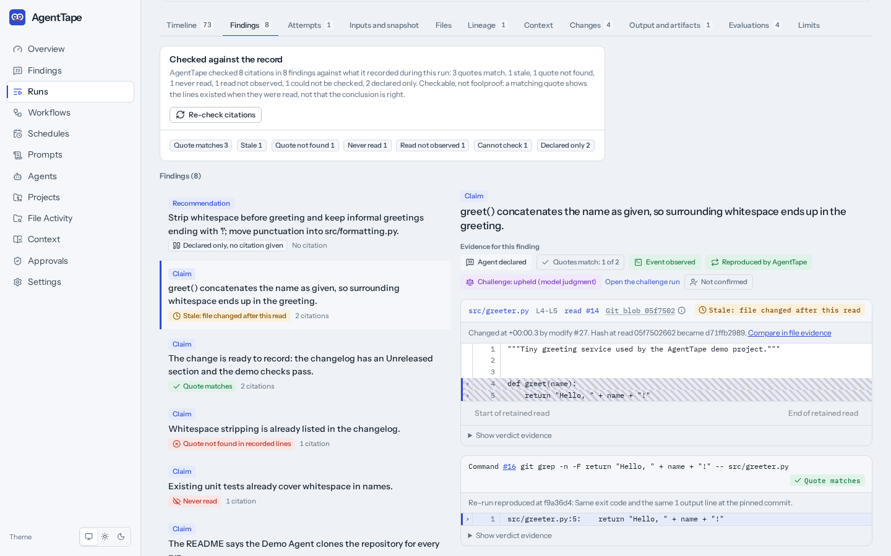

# Verified findings

Verified findings are how AgentTape keeps its promise of trust but verify. An agent records
what it found as a finding and cites its evidence: exact lines of a file it read, or the
recorded output of a command it ran. AgentTape, not the AI, checks each citation against
what AgentTape itself recorded during the run, and shows you the exact cited lines with a
verdict that says what it checked.

Checkable, not foolproof. A verdict says what AgentTape mechanically checked: whether the
quote appears in what the run read or recorded, whether the run read those lines at all,
and whether the file changed after the read. It never says that the finding's conclusion is
true. A well-cited finding can still be wrong, and the verdict will not tell you so.

The [Claude Code integration](integrations/claude-code.md) sets up finding capture
automatically in the runs AgentTape launches, and in your own interactive Claude Code
sessions after a one-time setup. Either way a finding exists only when the agent calls
the tool; nothing forces it to.

## Where you see findings

- **The run's Findings tab.** Every finding of the run, its citations with their
  verdicts, and the evidence ladder. Tally chips above the list filter it by verdict, and
  the run header shows the same tally.
- **The Findings inbox.** **Findings** in the sidebar lists findings across every run in
  a window (7, 14, or 30 days), flagged verdicts first, filterable by project, agent,
  verdict, kind, and source (Launched run or Observed session), with a text search.
- **The Overview.** Its "Verified findings" tile counts the findings in the window whose
  every citation's quote matched ("Every quote matched in N of M findings"), next to a
  breakdown by verdict, and links to the inbox. That tile's name is the only place the
  product calls a finding verified.
- **The Context tab.** A findings card with one row per finding and its worst verdict,
  each row opening the finding on the Findings tab.
- **Exports.** A run's export carries its findings with every citation's verdict,
  re-run result, and confirmation.



## A finding and its citations

An agent records a finding by calling the `record_finding` tool of the AgentTape MCP
server with:

- `kind`: free text of 1 to 32 characters. The contract AgentTape gives launched runs names
  bug, risk, recommendation, and decision; `review` is only for a reviewer run started by
  Challenge findings.
- `text`: the claim itself, 1 to 4000 characters.
- `citations`: up to 50 citations, each of one of the two shapes below. A finding with no
  citation is recorded and shown as "Declared only".
- `session_id` (optional): only for an interactive session AgentTape cannot tell apart
  from another in the same directory ([the `session_id`
  fallback](integrations/claude-code.md#the-session_id-fallback)).
- `target` (optional): only for a reviewer run started by Challenge findings.

| Shape | Field | Role |
|---|---|---|
| File citation | `path` | The file, relative to the run's working directory (up to 4096 characters). |
| | `quote` | **The evidence.** Text copied exactly from what the agent read, 1 to 4000 characters. |
| | `line_start`, `line_end` | A hint. AgentTape recomputes the true lines from where the quote matched and shows the agent's numbers alongside for comparison. |
| Event citation | `event_ref` | The `tool_use` id of a tool call or command whose output is quoted (up to 200 characters; an AgentTape event id also resolves). It resolves only within the same run. |
| | `quote` | **The evidence.** Text copied exactly from that call's recorded output, 1 to 4000 characters. |

```json
{"path": "src/greeter.py", "line_start": 4, "line_end": 5,
 "quote": "def greet(name):\n    return \"Hello, \" + name + \"!\""}
```

```json
{"event_ref": "toolu_01AbCdEf", "quote": "2 passed"}
```

Over the MCP tool, a field past its cap is refused before anything is sent: the agent gets
a validation error naming the field, and nothing is recorded. A finding that reaches AgentTape as
a telemetry event instead (the Demo Agent's scripted findings) is never refused: a quote
past 4000 characters is cut and marked, so that citation can only be "Cannot check"
(`quote_truncated`), and citations past the fiftieth are dropped and counted on the
finding. A path outside the run's project boundary is stored as `<outside>/<file name>`
and gets "Cannot check" (`outside_boundary`). Engine-level detail:
[EVENT-SCHEMA.md, "Finding citations"](EVENT-SCHEMA.md).

## How findings are recorded

| Kind of run | How findings arrive | Where its reads come from |
|---|---|---|
| Claude Code, launched by AgentTape | Automatic. Each attempt gets its own AgentTape MCP server, `mcp__agenttape__record_finding` is pre-approved unless the profile denies it, and the findings contract is appended to the system prompt. | Claude Code's own stream, from the process AgentTape started. |
| Your own interactive Claude Code session | After a one-time `agenttape mcp register`, every session has the `record_finding` tool. The session becomes an observed run inside a registered project. | Claude Code hooks, after a one-time `agenttape hooks setup`. Without hooks AgentTape sees no reads at all. |
| Claude Code in a Herdr pane | Through the same registered MCP server; the findings land on the Herdr run hosting the pane. | Claude Code hooks, as for an interactive session. |
| Demo Agent | Scripted findings in its telemetry, for the seeded demo and tests. No credentials, no model. | The Demo Agent's own telemetry. |
| Codex CLI and Generic Command | These runs cannot record findings. Their Findings tab says so and names the adapter. | Codex CLI reports no reads; a generic command reports none. |

A launched Claude Code run gets the findings contract (cite only text you read, read a
file before citing lines a search showed, copy quotes exactly, one call per finding)
automatically. An interactive session does not: the agent sees only the tool's own
description, so ask for findings in your request or in your project's instructions. Setup, the contract text to paste, and troubleshooting are
in the [Claude Code integration](integrations/claude-code.md).

## When AgentTape checks

- **Once, when the run finishes.** Verification runs automatically when a run reaches a
  final status: never during a run and never on a page load. An interactive session's run
  finishes when Claude Code ends the session, or after an idle timeout.
- **On request.** "Re-check citations" on a finished run's Findings tab, or `POST
  /api/v1/runs/{run_id}/findings/verify`, checks again.
- **History is append-only.** A re-check adds a verdict row that supersedes the last one;
  nothing is overwritten. The same recorded inputs always give the same verdict, and an
  automatic pass records nothing when the recorded inputs have not changed.
- **After an upgrade that changes a rule.** When `agenttape serve` starts, it re-checks
  once every finished run read through Claude Code hooks (an observed session, or a Herdr
  run hosting one) that still carries a "Never read" verdict from an older version of the
  checker.
- **How a quote is matched.** One normalization pass is applied the same way to what the
  run read and to the quote (line endings, Unicode NFKC, trailing whitespace), and then
  the quote must appear exactly. Case, tabs versus spaces, quote styles, and word order are
  never folded, and nothing is fuzzy or semantic: `if not authenticated:` never matches a
  quote reading `if authenticated:`. When several reads of the file contain the quote, the
  newest one decides.
- **Before the first check.** A citation shows "Checked when the run finishes" while the
  run is live, "Checking" just after it finishes, and "Not checked yet" if no verdict has
  arrived; never a provisional verdict.

## Verdicts: what each shows and what it does not

Every citation gets exactly one verdict. A finding with no citation gets the finding-level
state "Declared only" instead. The UI shows the label in the second column; the code is
what the API and exports carry.

| Verdict | Shown as | AgentTape checked | It shows | It does not show |
|---|---|---|---|---|
| `quote_matches` | Quote matches | The normalized quote is an exact substring of what this run read (a file citation) or of the cited call's recorded output (an event citation). | The quoted text was in what the run received, at the lines where it matched; the agent's own line numbers are shown alongside. | That the claim is true, that the lines support the claim, or that the file still reads that way. On an observed or Herdr-hosted session, not that the reported read matched the repository (see "Git blob" and "Reported output" below). |
| `stale` | Stale: file changed after this read | The quote matched a read, and File Evidence's own write history records a later write to that file in the same run. | The change event, and both content hashes when they can be established honestly. | That the finding is now wrong. The check uses AgentTape's recorded write history, never the live file, so it says nothing about the file after the run. |
| `quote_not_found` | Quote not found in recorded lines | The run read the cited file (or the cited event exists), and the normalized quote is not in what was returned. | The recorded lines and the agent's quote side by side. | That the agent was dishonest or the claim false: a paraphrase, a changed quote style, or a quote from another read all fail the same way. |
| `never_read` | Never read | No recorded read covers the cited lines (or the cited event is not in this run), and the evidence window is complete: AgentTape recorded every read that the run's telemetry or hooks reported (the rule is under "Limits" below). | That no telemetry or hook reported a read of the cited lines. When the run read other lines of the file, the reason names the lines it did read. | That the claim is false, or that the agent never saw the text. Claude Code loads instruction files such as `CLAUDE.md` without a read AgentTape can see, and text can arrive through a command's output rather than a read. |
| `read_not_observed` | Read not observed | No recorded read covers the cited lines, and the evidence window is incomplete: read telemetry was unavailable, AgentTape recorded an offline window, or a hook-read session has a gap. | That AgentTape could not have seen every read of this run. The citation says why in one sentence, followed by "AgentTape cannot tell whether" the file was read during that gap. | Anything about whether the file was read. It is neutral, not a milder "Never read". |
| `not_checkable` | Cannot check | The citation could not be compared, for exactly one of the eight reasons below. | The agent's quote and the reason. | Anything either way about the claim or the read. |
| `declared_only` (finding-level) | Declared only, no citation given | The finding has no citation, so there is nothing to check. | That the agent gave no evidence. | Anything either way about the claim. |

The eight reasons for "Cannot check", with the sentence the citation shows:

| Reason | Sentence |
|---|---|
| `outside_boundary` | The cited path is outside the run's repository boundary, so no read was recorded. |
| `no_quote` | The citation gives a line range but no quote to check. |
| `quote_truncated` | The quote was cut at 4,000 characters before it was recorded, so it cannot be matched exactly. |
| `no_content_recorded` | The read was recorded without its content. |
| `content_not_line_numbered` | The recorded read has no line numbers, so a line range cannot be located. |
| `size_cap_exceeded` | The cited text falls past the size cap on what AgentTape recorded: 1 MiB of a read, 16 KiB of an event. |
| `redacted_at_cited_span` | Text that looks like a secret was redacted inside the cited lines, so the quote cannot be compared. |
| `blob_unavailable` | The retained content is missing or could not be loaded. |

`redacted_at_cited_span` does not mean a real secret was there. The redaction patterns are
deliberately broad: they can match ordinary code such as `valid_token = bool(token)`, and
AgentTape applies them to the agent's own quote when it records the finding, so a citation
of code that handles credentials can get this reason with no secret in it.

The cited lines are always rendered from what AgentTape retained for that read, never from
the live file and never from the agent's quote (the "Quote not found" and "Never read"
views label the agent's text as the agent's). The citation header says where the retained
lines came from. "Git blob" followed by a short id means the exact lines are stored as a
Git object in the run's repository, which AgentTape checked exists; anything that can write
to the repository can add such an object, so this is not proof the lines were committed.
"Reported output" followed by a short hash means the lines were retained from the output
the agent reported, not anchored to a Git blob: it shows what was reported, not what the
repository contained. Retained copies are redacted, capped at 1 MiB, and deleted with the
run. A read recorded by Claude Code hooks is redacted with the secret values its attempt
resolved only while that attempt runs in the API's own process; otherwise (for example an
observed session) it is redacted with credential patterns and `AGENTTAPE_REDACT_ENV` values
only ([SECURITY.md](SECURITY.md) T16 lists the cases).

The event that records a read keeps only the first 16 KiB of its output (the event text
cap, [EVENT-SCHEMA.md](EVENT-SCHEMA.md)), so when a read returns more, AgentTape also keeps
the same redacted output, up to 1 MiB, and checks file citations against that. Lines past
1 MiB are "Cannot check" (`size_cap_exceeded`). If that copy is missing or cannot be read
when a citation is checked, the citation is "Cannot check" (`blob_unavailable`), never
checked against the first 16 KiB instead, and nothing is retained for the read, so a later
re-check tries the copy again. This holds for reads reported by Claude Code
hooks (a hook body is itself capped at 1 MiB, so a larger read is refused and never
recorded) and by a launched run (a launched Claude Code run's stream-json line is parsed
whole up to 8 MiB, enough for a 1 MiB read). An event citation of that read's result is
checked against the same copy, so a quote gets the same answer either way; its view shows
the event's first 16 KiB and says the check used the retained output. Any other event
citation is checked against the event's own recorded text, so a quote past its first
16 KiB is `size_cap_exceeded` too. A read recorded before AgentTape kept this copy is still
checked against its first 16 KiB.

## The evidence ladder

Every finding shows six rungs, always in this order. Rungs 2 to 5 are the four evidence
levels AgentTape adds on top of the agent's word; rung 6 is a person. The ladder is never
summed into a score, and no rung changes a citation's verdict.

| Rung | Achieved when | What it does not prove |
|---|---|---|
| 1. Agent declared | Always: the agent recorded the finding. | Anything. A declaration is a statement, not evidence. |
| 2. Quotes match | Every citation's latest verdict is "Quote matches" (shown as "Quotes match (n of n)"). | That the claim is true: each quote appears in what the run read, at the matched lines. |
| 3. Event observed | An event citation's quote matched the cited command's or tool call's recorded output. | That the output means what the agent says it means. |
| 4. Reproduced | AgentTape re-ran a cited command at the same commit and got the same answer ("Reproduced by AgentTape"). Otherwise it shows "Re-run queued", "Not reproduced", "Could not run", or "Not re-run". | That the conclusion drawn from the output is right; only that running it again gives the same answer. |
| 5. Challenge | A second agent read the same evidence and gave its opinion: upheld, refuted, or inconclusive, each labelled "(model judgment)". It can also read "Challenge running", "Challenge did not complete", "Challenge: not reviewed", or "Not challenged". | Anything: it is model judgment, never proof, whichever way it goes. |
| 6. Confirmed | A person confirmed the finding ("Confirmed by" the actor, and when), recorded in the audit log. Otherwise "Not confirmed". | That the person was right; it records who vouched for it. |

## Re-running a cited command

When a run finishes, AgentTape automatically re-runs, once per citation, every cited
read-only search: `grep`, `egrep`, `fgrep`, `rg`, or `git grep`. Any other recorded command
(tests, builds) is re-run only on request, with "Re-run command" on an event citation of a
finished run, or `POST /api/v1/citations/{citation_id}/reproductions`.

A re-run executes the exact argument list AgentTape recorded (never the finding's prose),
never through a shell, only when the command policy allows it outright, in a detached
snapshot of the repository at the run's base commit. A search is compared by exit code and
by its sorted, non-blank output lines, within 120 seconds. Any other command is compared by
exit status only, within the project's timeout and at most 10 minutes. If the run changed
files before the command ran, the result says the re-run used the base commit without
those changes. The result is "Reproduced by AgentTape", "Not reproduced" (with a
one-sentence reason), or "Could not run" (with the refusal), and it never changes the
citation's verdict. What is refused, and why: [CONTEXT-EVIDENCE.md, "Reproducing cited
commands"](CONTEXT-EVIDENCE.md#reproducing-cited-commands) and SECURITY.md T26.

## Challenging findings

"Challenge findings" in the header of a finished run with at least one finding asks a
second agent, on a reviewer profile you choose, to read the same findings and evidence.
The same is available from the command line and the API, and as a `finding_review` node in
a workflow, against an upstream `agent_run` node:

```bash
agenttape runs challenge <run-id> --profile "<reviewer profile name or id>" [--follow]
agenttape runs challenges <run-id>
```

`POST /api/v1/runs/{run_id}/challenge` starts one and `GET /api/v1/runs/{run_id}/challenges`
lists them. A challenge is an ordinary child run of the reviewer profile, with its own
timeline, usage, and cost. The reviewer sees the findings only as delimited, untrusted data,
never as instructions, and records upheld, refuted, or inconclusive for each finding. A
finding the reviewer skipped shows "not reviewed", and a reviewer run that failed shows "did
not complete". Every outcome is labelled model judgment, never proof, and never changes a
verdict. The reviewer's own findings and citations are checked like any other run's. The
tests prove how the reviewer's prompt is built and delivered, using a scripted reviewer;
they do not show that a real model resists prompt injection or flattery (SECURITY.md,
residual risks).

## Confirming a finding

On a finished run, "Confirm finding" records that a person vouches for a finding, with an
optional note of up to 2000 characters; "Withdraw confirmation" takes it back. Each appends
an audit log entry (`finding.confirm`, `finding.withdraw_confirmation`), and whether a
finding is confirmed is derived from the latest entry. A confirmation never changes a
verdict. API: `POST /api/v1/findings/{finding_id}/confirm` and `POST
/api/v1/findings/{finding_id}/confirm/withdraw`.

## Limits: checkable, not foolproof

- **Support is not checked.** AgentTape checks that the quoted text was in what the run
  read. Whether those lines support the claim is not checked; that is what Challenge
  (model judgment) and a person's confirmation are for.
- **Evidence on observed and Herdr-hosted sessions is reported by the session itself.**
  Hooks and interactive `record_finding` calls come from the Claude Code session being
  observed, which could also fabricate them. A "Quote matches" there shows the quote is
  consistent with what was reported. The "Git blob" label adds that the exact lines exist
  as an object in the run's repository, which anything able to write to the repository
  could also have added; "Reported output" adds nothing beyond the report.
- **Hosted sessions are matched by a reported directory.** A Claude Code session in a
  Herdr pane is matched to the Herdr run by the working directory the session reports,
  not by a secret of its own, and when two Claude Code sessions start at the same moment
  in one directory, a `record_finding` call from one can land on the other's run
  (SECURITY.md, residual risks).
- **When a missing read is Never read.** "Never read" requires a complete evidence window:
  AgentTape recorded every read the run's telemetry or hooks reported. For a Claude Code or
  Demo Agent run that AgentTape launched, that means its adapter reports reads and
  AgentTape recorded no offline window. A run whose reads come only from Claude Code hooks
  (an observed interactive session, or a Herdr run hosting Claude Code) must also show
  that the hooks covered it whole: every Claude Code session the run recorded (a Herdr
  pane can run several) began with a fresh `SessionStart` whose source is `startup` or
  `clear` (after `/clear` the conversation is empty), no hook event was dropped, and
  AgentTape did not restart while observing it. Otherwise the verdict is "Read not
  observed" and the citation names each gap:
  - `no_hooks`: an MCP finding created the run and no Claude Code hook ever reached it.
  - `coverage_unknown`: the session was recorded before AgentTape tracked when a
    session's hooks began.
  - `joined_mid_session`: the first hook AgentTape recorded was not a fresh
    `SessionStart`: the hooks were installed after the session started, the session
    was resumed (`resume`, `fork`, or `compact`), or the hooks came from an older
    `agenttape hooks setup` that installed `SessionStart` as an `http` hook, which Claude
    Code never runs (run `hooks setup` again: `SessionStart` is now a `command` hook,
    [integrations/claude-code.md](integrations/claude-code.md#agenttape-hooks-setup--remove--status)).
  - `dropped_hook_events`: hook events were refused (rate limit, full ingest queue) or
    could not be recorded.
  - `observer_restarted`: AgentTape restarted while the session was open. Claude Code's
    hooks fail silently while AgentTape is down, so hooks sent meanwhile were lost.

  Every MCP-only session and every resumed session is therefore "Read not observed". A gap
  anywhere in a session counts, even one recorded after every finding, because a lost hook
  cannot always be placed in time. To make "Never read" possible at all, install hooks
  first, keep AgentTape running, and start a new session. A Herdr run whose Claude Code
  pane no hook ever reached has no read telemetry, so a missing read there is "Read not
  observed" too.
- **Instruction files are never read, as far as AgentTape can see.** Claude Code loads
  `CLAUDE.md`, the files it imports, and files you @-mention into the conversation without
  a `Read` tool call, so no telemetry or hook reports them, on launched runs too. A citation
  of their text has no read to match: it is "Never read" on a complete window and "Read not
  observed" otherwise, even though the text was in the agent's context.
- **Hook coverage has known limits of its own.** A hook sent with a stale or wrong token is
  never counted as dropped; dropped counts wait in memory until the session's next hook,
  finding, or idle close, and an AgentTape restart loses them (though what is lost then
  came after the session's last recorded finding); and a hook delayed past Claude Code's
  3-second timeout but still received can be ordered after a finding it preceded. The full
  list is in [SECURITY.md, residual risks](SECURITY.md#residual-risks-known-and-accepted-for-v1).
- **Which reads count.** Only reads through read tools (Claude Code's `Read`, the Demo
  Agent's reads) and a narrow set of read-only shell commands (`cat`, `head`, `tail`, and
  `sed -n` with a line range, with no pipes or other shell syntax) count as reads. Search
  output is not a read: lines an agent saw only in a `Grep` or `Glob` result, and cited as
  a file citation, are "Never read" on a complete window. Text obtained any other way
  should be cited as an event citation of that tool call's or command's output, or the
  agent should `Read` the file before citing it. The findings contract and the
  `record_finding` tool description both say so.
- **Automatic re-runs cover read-only searches only.** Tests and builds are re-run only
  when someone asks, and a re-run never changes a verdict.
- **Codex CLI and Generic Command cannot record findings.** Their runs are recorded and
  orchestrated like any other, but they have no way to cite evidence.
- **One labelled stand-in in the seeded demo.** The demo's evidence window is complete, so
  it has no genuine "Read not observed" verdict; the seed adds one row with method `seeded`
  on top of the engine's own verdict for that citation, and its reason starts "Seeded demo
  stand-in". Every other seeded verdict comes from the real engine.

## Reference

- [EVENT-SCHEMA.md](EVENT-SCHEMA.md): "Finding citations" and "Review findings".
- [CONTEXT-EVIDENCE.md](CONTEXT-EVIDENCE.md): "Citation verification" and "Reproducing
  cited commands".
- [SECURITY.md](SECURITY.md): threats T23 to T29 and the residual risks.
- [API.md](API.md): the findings, verification, reproduction, challenge, and confirmation
  endpoints.
- [Claude Code integration](integrations/claude-code.md): setup for launched runs,
  interactive sessions, and Herdr, and troubleshooting.
