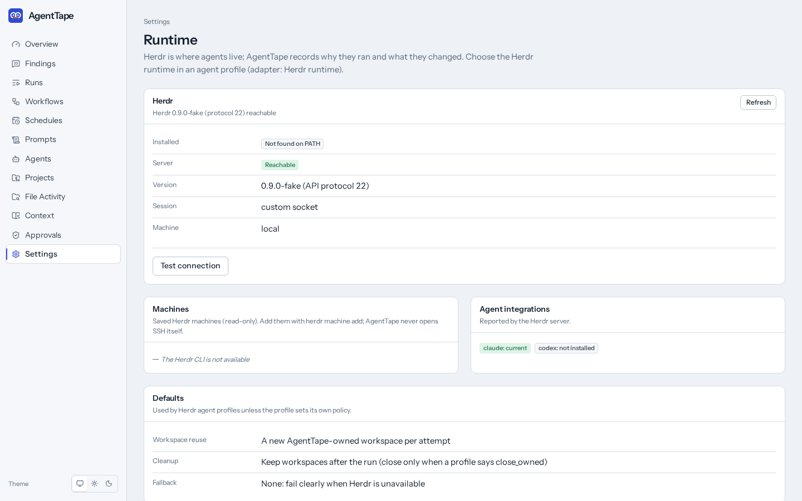

# Herdr runtime

Herdr is where agents live; AgentTape records why they ran, governs what they may do,
proves what they changed, and evaluates the result. This page covers setup, configuration,
what AgentTape can and cannot observe through Herdr, restart behavior, and troubleshooting.
The decision is recorded in [ADR 0009](adr/0009-herdr-runtime.md).

AgentTape works without Herdr: the local adapters (`claude-code`, `codex-cli`,
`generic-command`) and the Demo Agent (`demo`) run as child processes of the worker, as
before. Herdr is optional and never needed for onboarding or the test suite.



## Setup

1. Install Herdr (verified with Herdr 0.9.0, API protocol 22) and start it: run `herdr`,
   or a headless named session with `herdr --session NAME server`.
2. Point AgentTape at the session (environment, see `config.py`):

   | Variable | Default | Meaning |
   |---|---|---|
   | `AGENTTAPE_HERDR_SESSION` | empty (Herdr's default session) | Named session; the socket is `~/.config/herdr/sessions/NAME/herdr.sock` |
   | `AGENTTAPE_HERDR_SOCKET` | empty | Explicit API socket path (overrides the session) |
   | `AGENTTAPE_HERDR_EXECUTABLE` | `herdr` | The CLI, used read-only for `--version` and `machine list --json` |
   | `AGENTTAPE_HERDR_MACHINE` | `local` | Label of the machine the socket reaches (see Remote machines) |

   `herdr session list` prints every session and its socket.
3. Open **Settings, Runtime** and press **Test connection**. It checks the CLI, the socket,
   ping, the API protocol, the agent API, and the event subscription, with a hint for each
   failure. The test is recorded in the audit log.
4. Create an agent profile with the **Herdr runtime** adapter (Agents, New profile).

## Profile configuration

| Key | Values | Meaning |
|---|---|---|
| `agent_kind` | `claude`, `codex`, `demo` | Claude Code or Codex started by Herdr with `agent.start`, or the evidence demo agent run as a command in a pane |
| `workspace_policy` | `new` (default), `reuse` | `new`: an AgentTape-owned workspace per attempt, in the run's working directory. `reuse` needs one of the two keys below |
| `reuse_workspace_id` | e.g. `w3` | Open an AgentTape-owned tab in this existing workspace (the workspace is not owned) |
| `reuse_agent` | a live agent name | Prompt this existing, idle Claude Code or Codex agent instead of starting one (nothing is owned) |
| `cleanup` | `keep` (default), `close_owned` | `close_owned` closes the workspace or tab AgentTape created when the attempt finishes. Never anything else |
| `fallback` | `none` (default), `local` | `local`: if Herdr is unavailable *before* the attempt starts, run the equivalent local adapter (`claude-code`, `codex-cli`, or `demo`) and record a `fallback` runtime event. Nothing falls back after a Herdr start |
| `local_config` | object | Config for that local adapter (default for `demo`: `{"scenario": "full_evidence"}`). After a fallback the attempt's events and file evidence are labelled with the local adapter |
| `variant`, `step_delay_ms` | `a`/`b`, 0-10000 | Demo kind only: as for the Demo Agent's `full_evidence` scenario |

The usual limits (`timeout_seconds`, `idle_timeout_seconds`, `max_attempts`, budgets,
evaluators) apply as for every adapter. A profile with `fallback: local` is the "auto"
mode: Herdr when healthy, local otherwise, visibly.

## What happens during a run

- **claude / codex**: AgentTape creates the workspace (or tab), starts the agent with a
  name like `at-1a2b3c4d-a1`, sends the resolved prompt with `agent.prompt` (secret values
  are resolved only for this call and never stored; a restart between sending it and
  recording that it was sent never sends it twice), and follows the lifecycle through
  `events.subscribe`, polling `agent.get` every 2 s while the stream is down and every 10 s
  as a safety net. The attempt succeeds when the agent settles (`idle` or `done`) after a
  turn was observed. `unknown` is never treated as completion. At the end AgentTape saves
  the agent's recent visible output (`agent.read`) as the artifact
  `herdr-recent-output.txt`.
- **blocked**: when Herdr reports the agent waiting on an approval or question, AgentTape
  records a `blocked` runtime event with the attach command and leaves the agent untouched
  until a person answers it in Herdr. Waiting on a person does not count as idleness: the
  run stays `running` (the Runtime tab shows the session `blocked`), and only the
  wall-clock timeout ends it. A run that is still blocked then ends `timed_out`, and even
  then AgentTape does not send keys to the blocked agent.
- **demo**: AgentTape types an AgentTape-built command (never user text) into the pane:
  `python -m agenttape.demo_agent --workdir DIR --telemetry FILE --phase start --variant V
  --step-delay-ms N`, the same command, working directory (the run's isolated worktree of
  the fixture repository, else a private clone of it), and `protected_path` approval as the
  Demo Agent's local `full_evidence` scenario, so a Herdr run records the same file and
  context evidence. Run it in the "AgentTape Evidence Demo" project; the profile keys
  `variant` and `step_delay_ms` mean what they mean for the Demo Agent. AgentTape reports
  the pane's state to Herdr (`working`, `blocked` while an approval is pending, `idle`),
  tails the telemetry file through the Demo Agent's normalizer, and finishes on the final
  `exit` record. Exit 3 pauses the run for approval; approving it runs `--phase resume` in
  the same pane. The telemetry file is the demo's output; the pane is not saved.
- **Cancel / timeout**: `ctrl+c` through `agent.send_keys` (or `pane.send_keys` for the
  demo), unless the agent is blocked.
- **Audit**: every start, prompt, wait (state change), read, interrupt, reconnect,
  fallback, and cleanup is a `runtime` event in the run timeline. Payloads carry Herdr ids
  and states only; never socket paths, prompt text, or native session values.

## Restart and reconnection

AgentTape persists each attempt's Herdr identity in `runtime_sessions` as soon as the pane
exists and updates it on every sync. If AgentTape stops (a graceful shutdown or a crash
whose worker lease then expires), an attempt whose Herdr session is recorded active is
**not** failed. It is parked and re-queued; the next worker reopens the same attempt and:

1. pings Herdr and checks that the pane still hosts the agent AgentTape started (same agent
   name or demo label, same terminal);
2. records a `runtime` event `{"action": "reconnect", "offline_from", "offline_to"}` (File
   and Context Evidence mark that window as incomplete; nothing is fabricated for it);
3. continues observing. For the demo agent it resumes the telemetry file at the stored
   byte offset; telemetry events have deterministic ids, so a line that was recorded just
   before the stop is not recorded again.

A closed pane or workspace (or a Herdr restart, which invalidates ids) fails the attempt
with `stale_id`; a pane that now hosts a different agent fails with `agent_replaced`; an
unreachable Herdr fails with `unavailable` after a 30 s grace. Nothing falls back to local
execution after the attempt started.

## What AgentTape can and cannot observe through Herdr

| Capability | Herdr: Claude Code / Codex | Herdr: demo agent | Local: Claude Code / Codex | Local: Demo Agent |
|---|---|---|---|---|
| Start | Supported (`agent.start`) | Supported (command in pane) | Supported (child process) | Supported |
| Prompt | Supported (`agent.prompt`) | Degraded (fixed scenario) | Degraded (once, at start) | Degraded (once, at start) |
| Lifecycle state | Supported: idle, working, blocked, done, unknown | Supported (reported by AgentTape) | Degraded: running or exited | Degraded: running or exited |
| Event push | Supported (`events.subscribe`, polling fallback) | Supported | Supported (stdout stream) | Supported |
| Recent output | Degraded: recent screen text only; alternate-screen output is not in scrollback | Supported (telemetry file) | Supported (full stdout/stderr) | Supported |
| Interrupt | Supported (`ctrl+c`; never while blocked) | Supported | Supported (SIGTERM, SIGKILL) | Supported |
| Reattach after restart | Supported | Supported (telemetry offset) | Not supported (the process dies with the worker) | Not supported |
| Interactive attach | Supported (`herdr agent attach`) | Supported | Not supported | Not supported |
| Tool-level file telemetry | Supported for Claude Code once `agenttape hooks setup` is installed in that Claude Code session (its pane attaches to the Herdr run as `hosted`; tool events land on the Herdr run/attempt, `source: claude-code-hook`, and a cited file with no recorded read is `never_read` only when those hooks covered every Claude Code session the pane ran, each from its fresh `SessionStart`, with none dropped and no AgentTape restart, including between two sessions; a `claude --resume` in the pane, or a later session whose hooks began mid-way, makes the whole run `read_not_observed`); otherwise **not supported** (and never for Codex): Herdr reports state, not tool calls | Supported (telemetry records) | Supported (stream-json / JSON events) | Supported |
| Token usage and cost | **Unavailable** | Simulated, labelled | As reported by the CLI | Simulated, labelled |

The same table, with notes, is on Settings, Runtime and in the API (`GET /runtime/herdr`,
`runtime_capabilities`). Consequences for evidence:

- For Claude Code and Codex under Herdr, AgentTape cannot see which files the agent read.
  Writes, creations, renames, and deletions are still established by filesystem
  observation and the final Git reconciliation of the run's working directory; reads are
  shown as not captured, never guessed.
- AgentTape never sees hidden reasoning or the provider's internal prompts, through Herdr
  or otherwise. `agent.read` returns what is visible in the terminal.
- The native session reference (Claude Code or Codex session id or path) is recorded only
  as "reported (id)" or "reported (path)"; its value is not stored.

## Opening a run in Herdr

The run's **Runtime** tab shows the runtime badge, machine, workspace (and whether
AgentTape owns it), pane, agent name and kind, lifecycle state, native session status, last
sync, and a copyable command such as:

```
herdr agent attach at-1a2b3c4d-a1
herdr --session work agent attach w3:p1
```

A browser cannot attach to a terminal, so "Open in Herdr" is a command to run in a
terminal, not a link.

## Remote machines

Herdr manages SSH machines (`herdr machine add`, `herdr --remote TARGET`). AgentTape
contains no SSH code: it talks to one configured socket. Settings, Runtime lists saved
machines read-only from `herdr machine list --json` (label, target, enabled; nothing
else). To run agents on a remote machine, run AgentTape where that machine's Herdr socket
is reachable (for example on that machine, or with a socket forwarded by your own SSH
setup) and set `AGENTTAPE_HERDR_MACHINE` to the machine's label. Runs then record that
label, and the Runtime tab tells you to select the machine in Herdr instead of printing a
local attach command. Ids like `w1:p1` are scoped to one server.

## Troubleshooting

| Symptom | Cause and fix |
|---|---|
| Settings, Runtime says "Herdr server not reachable (unavailable)" | No server on the socket. Start Herdr (`herdr`, or `herdr --session NAME server`), or set `AGENTTAPE_HERDR_SESSION` to a running session (`herdr session list`) |
| "Herdr CLI installed: the herdr command was not found" | Only the version and machine list need the CLI; runs use the socket. Install Herdr or set `AGENTTAPE_HERDR_EXECUTABLE` |
| Runs fail with `adapter_unavailable` before starting | Herdr was down at start. Start it, or set the profile's fallback to `local` |
| Protocol older than supported | Update Herdr (`herdr update`). Newer protocols run with a warning event |
| Run fails with `stale_id` | The pane or workspace was closed, or Herdr restarted (ids are not reused). Retry the run |
| Run fails with `agent_replaced` | Something else took over the pane. Retry the run |
| Run stays running with a `blocked` event | The agent is waiting for you. Attach with the command on the Runtime tab and answer it |
| Event subscription check fails | Runs still work: AgentTape polls `agent.get` (every 2 s) instead |
| `timeout: agent showed no activity within 60s of the prompt` | The agent never started working after `agent.prompt`. Attach and look at it; it may be waiting on a startup dialog |

## Security notes

- AgentTape never passes user text through a shell. The demo command line is built by
  AgentTape from fixed arguments and quoted with `shlex.join` before it is typed into the
  pane; Claude Code and Codex receive the prompt through `agent.prompt`.
- Socket paths and native session values never appear in the UI, events, API responses,
  or exports. Artifacts pass through the usual secret redaction.
- AgentTape only closes workspaces or tabs it created and recorded as owned, and only when
  the profile says `cleanup: close_owned`. It never stops a Herdr server or session.

## Testing

`backend/tests/fixtures/fake_herdr.py` implements the subset of the API AgentTape uses,
including simulated Claude Code and Codex agents (a prompt containing `BLOCK`, `UNKNOWN`,
or `HANG` exercises those states). It runs in-process for the integration tests
(`tests/integration/test_herdr_runtime.py`) and standalone for Playwright
(`scripts/e2e-server.sh`); its panes run the real evidence demo agent, and one integration
test checks that a Herdr demo run records the same file ledger and context trail as a local
`full_evidence` run. `tests/fixtures/herdr_protocol.json` holds request/response pairs and
schema excerpts captured from a real Herdr 0.9.0 (protocol 22); unit tests check that every
method AgentTape calls exists in that schema, that the client parses the real responses,
and that the fake answers the same requests with the same shapes, so drift in either
direction fails a test. The test suite never contacts a real Herdr session or CLI.
